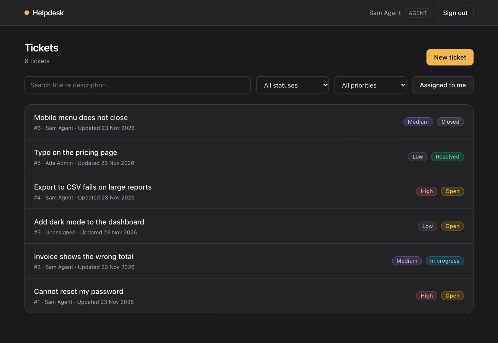
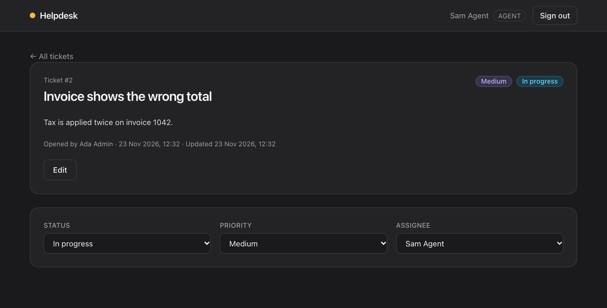
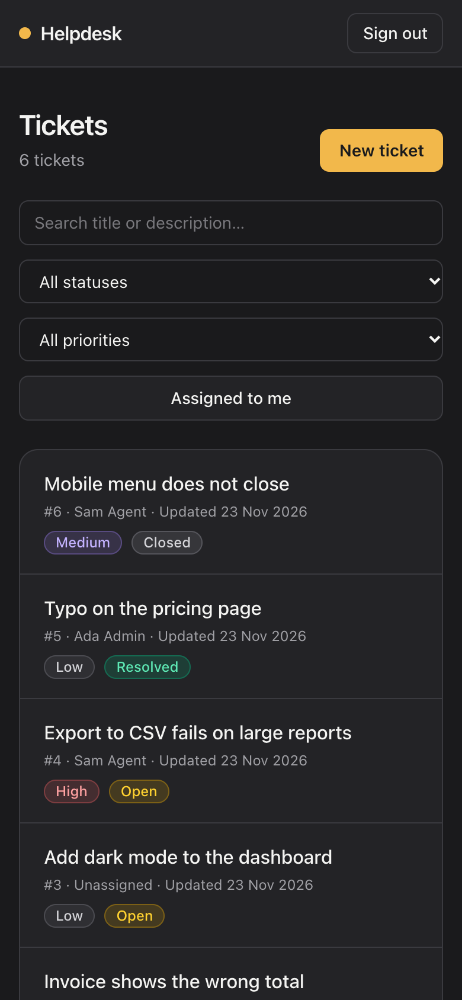
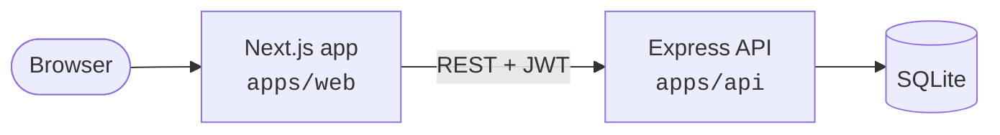

# Helpdesk

A small full-stack helpdesk. Agents sign in, then create, search, assign and resolve support tickets. Built with a **Next.js** web app and a **Node.js** REST API.

[](https://github.com/malik7224/helpdesk-fullstack/actions/workflows/ci.yml)

<p>
  
</p>
<p>
  
  
</p>

## Features

- **Sign in** with email and password. Sessions use signed tokens in an httpOnly cookie that expire after 8 hours.
- **Tickets**: create, edit, view, and delete (admins only).
- **Comments**: a discussion thread on every ticket.
- **Search and filters**: text search over title and description, plus status, priority and assignee, with paging.
- **Roles**: *agents* work tickets, *admins* also manage users and delete tickets.
- **Responsive** layout that works on a phone.

## Tech stack

| Layer | Tools |
|---|---|
| Web | Next.js 16 (App Router), React 19, TypeScript, Tailwind CSS 4 |
| API | Node.js, Express 5, TypeScript, Zod 4 for validation |
| Data | SQLite through Node's built-in `node:sqlite` (no native build step) |
| Auth | scrypt password hashing, JWT (HS256) |
| Quality | Vitest, Supertest, ESLint (both apps), GitHub Actions CI |

## Architecture



An npm-workspaces monorepo. The web app is a client of the API and shares no code with it. The API validates every request with Zod, checks the signed-in user's role per route, and talks to SQLite with prepared statements.

```
apps/
  api/   Express API: routes, auth, validation, database, tests
  web/   Next.js app: pages, components, API client, tests
docs/    Screenshots
```

## Quick start

You need **Node.js 22.13 or newer**.

```bash
git clone https://github.com/malik7224/helpdesk-fullstack.git
cd helpdesk-fullstack
npm install
npm run seed       # creates a local database with two demo users and sample tickets
```

Run the API and the web app in two terminals:

```bash
npm run dev:api    # http://localhost:4000
npm run dev:web    # http://localhost:3000
```

Open http://localhost:3000 and sign in with a **demo account** (fake data, local use only):

| Email | Password | Role |
|---|---|---|
| `agent@demo.test` | `demo-password-123` | agent |
| `admin@demo.test` | `demo-password-123` | admin |

### Configuration

Both apps work without any setup. To change settings, copy `apps/api/.env.example` to `apps/api/.env` and `apps/web/.env.example` to `apps/web/.env.local`. In production the API **requires** a real `JWT_SECRET` and refuses to start without one.

## Scripts

| Command | What it does |
|---|---|
| `npm run dev:api` / `npm run dev:web` | Start a dev server with reload |
| `npm test` | Run all tests (API and web) |
| `npm run typecheck` | Type-check both apps |
| `npm run lint` | Lint both apps |
| `npm run build` | Build both apps |

## API overview

| Method and path | Who | Purpose |
|---|---|---|
| `GET /health` | anyone | Liveness and database check |
| `POST /auth/login` | anyone | Sign in. Sets the session cookie and also returns the token for API clients |
| `POST /auth/logout` | anyone | Clear the session cookie |
| `GET /auth/me` | signed in | The current user |
| `GET /users` | signed in | List users (for the assignee picker) |
| `POST /users` | admin | Create a user |
| `GET /tickets` | signed in | List tickets. Query: `q`, `status`, `priority`, `assigneeId`, `page`, `pageSize` |
| `POST /tickets` | signed in | Create a ticket |
| `GET /tickets/:id` | signed in | One ticket |
| `PATCH /tickets/:id` | signed in | Update any ticket fields |
| `GET /tickets/:id/comments` | signed in | List a ticket's comments, oldest first |
| `POST /tickets/:id/comments` | signed in | Add a comment (1 to 2000 characters) |
| `DELETE /tickets/:id` | admin | Delete a ticket |

Errors are JSON: `{ "error": "..." }`, and validation errors add an `issues` list of `{ path, message }`.

## Design decisions

- **Accounts are created by admins**, not by open sign-up. A helpdesk should not let strangers become agents.
- **Passwords** are hashed with scrypt and a per-user salt, and compared in constant time. Unknown emails and wrong passwords return the same error and take about the same time.
- **Tokens are re-checked against the database** on every request, so a deleted user or changed role takes effect immediately.
- **The session is an `httpOnly` cookie** (`SameSite=Lax`, `Secure` in production), so page scripts and XSS cannot read the token. Writes that rely on the cookie must come from the web app's origin, which blocks cross-site request forgery. API clients can still send `Authorization: Bearer <token>`.
- **Login is rate limited** (10 attempts per 15 minutes per IP).
- **Search is safe**: `%` and `_` in a query are matched as plain text.
- **`node:sqlite`** keeps setup to one command. Swapping in PostgreSQL would only touch `db.ts` and the queries in the route files.

## Known limitations

These are deliberate simplifications for a demo, and where I would go next:

- The cookie uses `SameSite=Lax`, so in production the web app and API must share a site (for example `app.example.com` and `api.example.com`). Deploying them on unrelated domains would need `SameSite=None` and a CSRF token.
- The rate limiter is in memory, so it works for one server process only. Several instances need a shared store such as Redis.
- No password reset, refresh tokens or audit log. Comments cannot be edited or deleted yet.

## Tests


```bash
npm test
```

## License

[MIT](LICENSE) © 2026 Malik Ali
