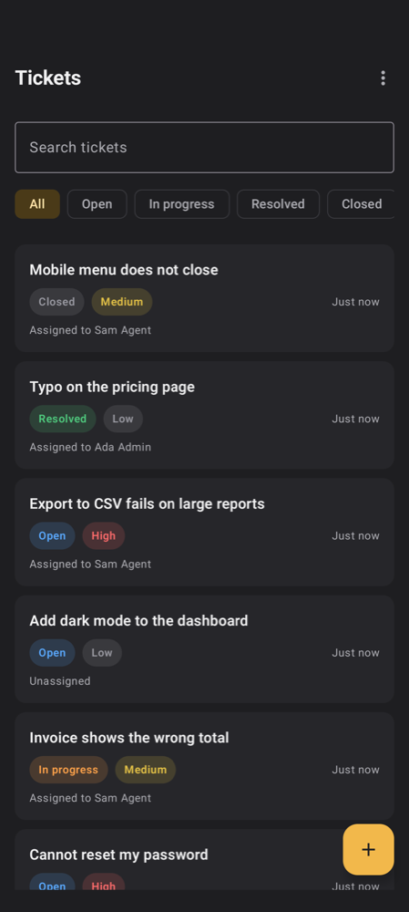
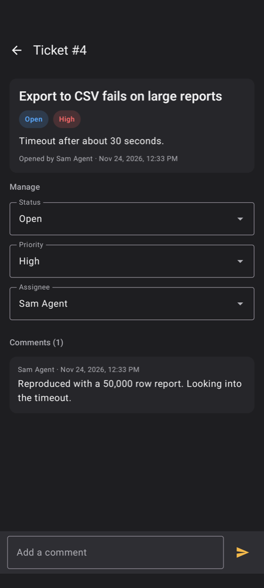
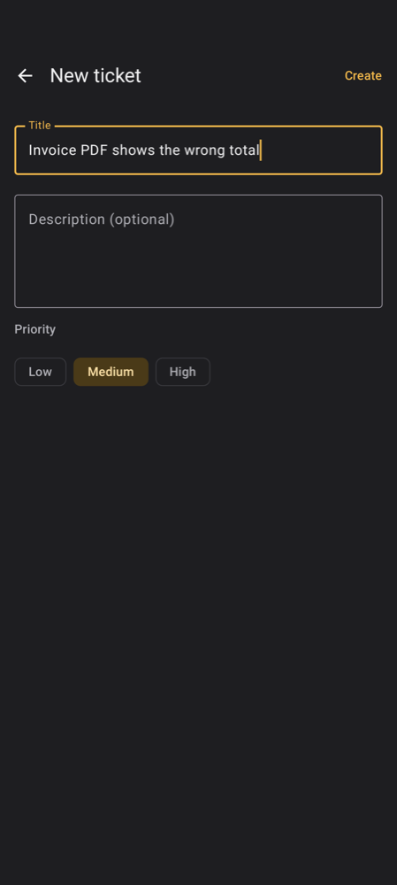

# Helpdesk for Android

A native Android client for the Helpdesk API, built with Kotlin and Jetpack Compose. Sign in, browse and search tickets, change status, priority and assignee, read and post comments, and create tickets.

<p>
  
  
  
</p>

## What is inside

- **Jetpack Compose** with Material 3, `ViewModel` and `StateFlow`. Light and dark themes.
- **`ApiClient`** wraps OkHttp with coroutines. It sends the token as a Bearer header, runs off the main thread, cancels with the screen, and turns server errors into readable messages.
- **Android Keystore** encrypts the sign-in token (AES-GCM) before it is saved. `SessionStore` never writes it as plain text.
- **Navigation Compose** for the list, detail and new-ticket screens. Android 8.0 (API 26) and later.

## Run it

You need Android Studio (or the Android SDK) and JDK 17 or newer.

1. Start the API from the repo root:

   ```bash
   npm install
   npm run seed
   npm run dev:api
   ```

2. Run the app from Android Studio (open the `apps/android` folder), or from a terminal with an emulator running:

   ```bash
   cd apps/android
   ./gradlew installDebug
   ```

3. Sign in with `agent@demo.test` / `demo-password-123` (fake demo data).

The emulator reaches the API at `http://10.0.2.2:4000`. On a real phone, open **Server** on the sign-in screen and enter your computer's address on the same Wi-Fi, for example `http://192.168.1.20:4000`.

On Android 17 the app asks for permission to reach devices on your network the first time you sign in to a local server. Allow it, then the sign-in continues.

## Tests

```bash
cd apps/android
./gradlew testDebugUnitTest
```

- **Unit tests** (13) run the API client against a fake local server with OkHttp's `MockWebServer`. They cover login, the Bearer header, query building, date parsing, error mapping, partial updates and network failures. They run in CI.
- **End-to-end tests** (`EndToEndTest`) drive the real app on an emulator against a running API: wrong password, sign in, open a ticket, post a comment and create a ticket. They need a server, so CI does not run them:

  ```bash
  ./gradlew connectedDebugAndroidTest
  ```

## Known limitations

- Tickets cannot be edited (title or description) or deleted in the app yet.
- No push notifications, offline mode or tablet layout.
- Debug builds allow plain `http` so the app can reach a local API. Release builds only allow `https`.
