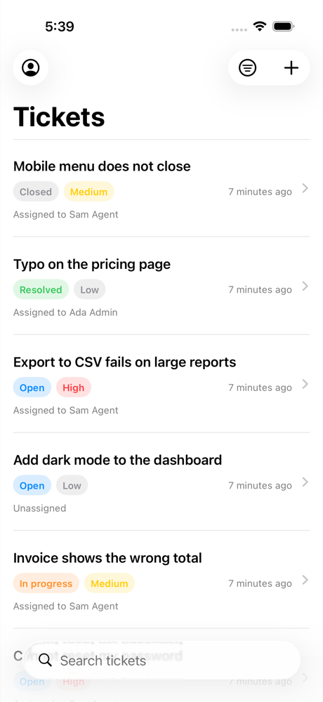
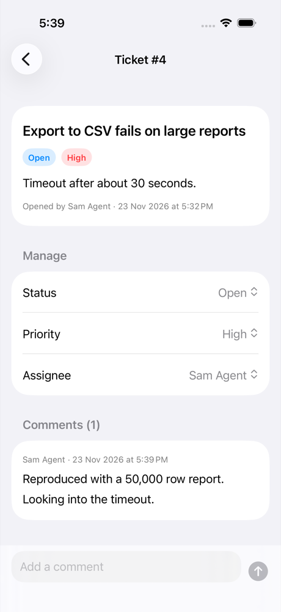
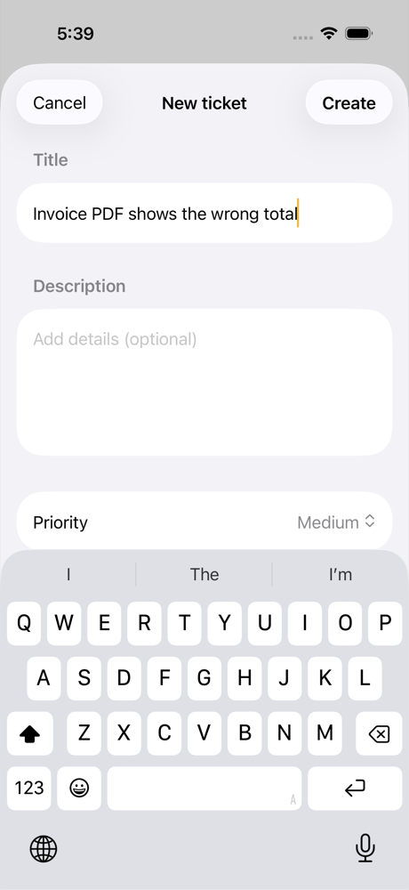

# Helpdesk for iPhone

A native SwiftUI client for the Helpdesk API. Sign in, browse and search tickets, change status, priority and assignee, read and post comments, and create tickets.

<p>
  
  
  
</p>

## What is inside

- **SwiftUI** with the `@Observable` model. No third-party packages.
- **`APIClient`** is a small `async/await` wrapper over `URLSession`. It sends the token as a Bearer header and turns server errors into readable messages.
- **Keychain** holds the sign-in token (`TokenStore`), not `UserDefaults`.
- **Swift 6** language mode, iOS 17 and later.

## Run it

You need Xcode 16 or newer and [XcodeGen](https://github.com/yonaskolb/XcodeGen) (`brew install xcodegen`). The Xcode project is generated from `project.yml`, so it is not committed.

1. Start the API from the repo root:

   ```bash
   npm install
   npm run seed
   npm run dev:api
   ```

2. Generate and open the project:

   ```bash
   cd apps/mobile
   xcodegen generate
   open Helpdesk.xcodeproj
   ```

3. Run the **Helpdesk** scheme on an iPhone simulator and sign in with `agent@demo.test` / `demo-password-123` (fake demo data).

The simulator reaches the API at `http://localhost:4000`. On a real iPhone, open **Server** on the sign-in screen and enter your computer's address on the same Wi-Fi, for example `http://192.168.1.20:4000`.

## Tests

```bash
xcodegen generate
xcodebuild test -project Helpdesk.xcodeproj -scheme Helpdesk \
  -destination 'platform=iOS Simulator,name=iPhone 17 Pro'
```

- **Unit tests** (`HelpdeskTests`, 9 tests) check the API client against stubbed responses: login, the Bearer header, query building, date decoding, error mapping and partial updates. They run in CI.
- **End-to-end tests** (`HelpdeskUITests`) drive the real app against a running API: sign in, open a ticket, post a comment and create a ticket. They need a server, so they are not part of the default run. Use the `HelpdeskUI` scheme.

## Known limitations

- Tickets cannot be edited (title or description) or deleted in the app yet.
- No push notifications, offline mode or iPad layout.
- The app talks to the API over plain HTTP for local development. A production build should use HTTPS and drop the local-network exception in `project.yml`.
